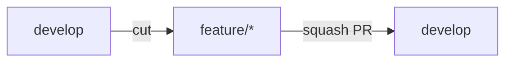
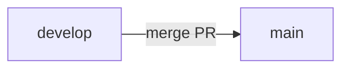
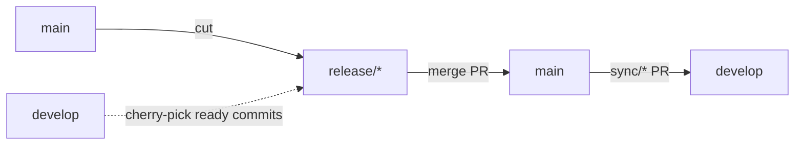
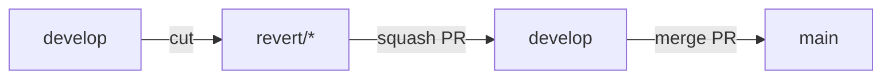
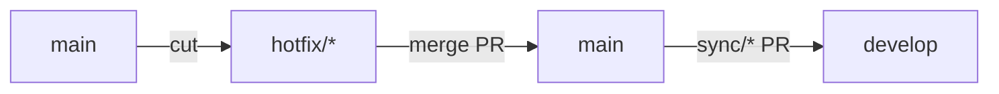
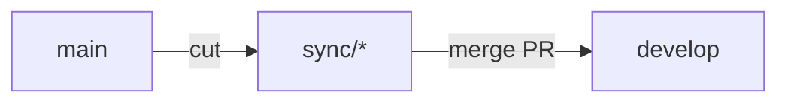
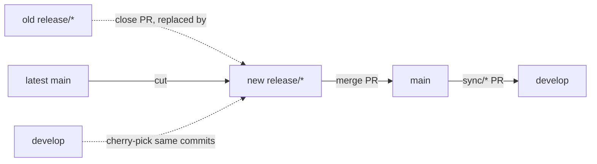
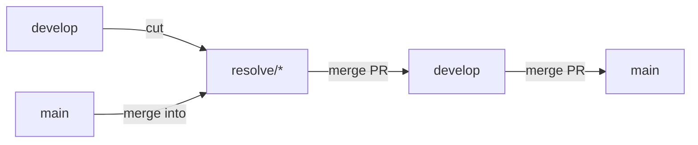

# Git branching strategy

How the team moves work from development to staging (`develop`) and production (`main`). Start with section 1. Read further only when you need to.

## 1. What do I do?

| Situation | What to do | How |
|---|---|---|
| Start new work | Create a feature branch from `develop` | [4.1](#41-start-a-feature) |
| Everything on `develop` is ready | Ship `develop → main` | [4.2](#42-ship-develop--main) |
| Several items on `develop` are unfinished | Release only the ready work, then sync | [4.3](#43-release-only-the-ready-work), [4.6](#46-sync-main--develop) |
| One or two items on `develop` are unfinished | Revert them on `develop`, then ship `develop → main` | [4.4](#44-revert-unfinished-work) |
| Urgent bug in production | Hotfix into `main`, then sync | [4.5](#45-hotfix), [4.6](#46-sync-main--develop) |
| `main` changed while a release PR is open | Close it and rebuild the release from `main` | [4.7](#47-rebuild-an-open-release) |
| The `develop → main` PR conflicts | Resolve on a `resolve/*` branch | [4.8](#48-resolve-a-conflict-on-develop--main) |

Release and revert are fallbacks for when unfinished work still reaches `develop`. The goal is to need them rarely. If unsure between them, use a release branch.

## 2. Rules

| Every developer | Why |
|---|---|
| One small feature per PR. | Easy to review, cherry-pick and revert. |
| Merge into `develop` only work that can ship. Hide unfinished work behind a feature flag, off by default. | `develop` stays shippable. |
| Remove a feature flag once the feature is live. | Old flags make the code hard to follow. |
| Add automated tests in the same PR. Merge only when CI passes. | Less manual testing before shipping. |
| State dependencies on other features in the PR description. | A dependent feature can't be cherry-picked alone. It ships with what it depends on. |
| Merge the latest `develop` into your branch before opening the PR. | Conflicts are fixed on your branch. |
| Never commit to `main`, `develop` or `release/*` directly. Use a PR. | Every change is reviewed. |

| Whoever ships | Why |
|---|---|
| Ship `develop → main` often. | A release branch is rarely needed. |
| After a release or hotfix merges into `main`, sync `main → develop`. Not needed after `develop → main`. | Skipping it made the next `develop → main` PR conflict. |
| Cut a release from the latest `main`. If `main` changes while it is open, rebuild it. | The release always includes production fixes. |
| Fix release bugs on `develop` first, then cherry-pick. | A fix on the release branch conflicts at sync and is lost on rebuild. |
| Cherry-pick with `-x` and list the SHAs in the release PR description. | Anyone can rebuild the release. |
| A hotfix merges into `main` only. | `develop` gets it through the sync. |
| One revert PR per feature. | Each revert can be undone on its own. |
| Resolve conflicts on `sync/*` or `resolve/*`, never on `develop`. | The shared branch stays clean. |

## 3. Branches

| Branch | Purpose | Cut from | Merges into | PR merge method |
|---|---|---|---|---|
| `main` | Production. Always deployable. | | | |
| `develop` | Staging, also called **nonprod**. Features are merged here before they go to production. | | `main` | Merge commit |
| `feature/*` | Development work | `develop` | `develop` | Squash |
| `release/*` | Ships only the ready work. Optional. | `main` | `main` | Merge commit |
| `hotfix/*` | Urgent production fix | `main` | `main` | Merge commit |
| `sync/*` | Brings `main` into `develop` after a release or hotfix | `main` | `develop` | Merge commit |
| `revert/*` | Removes unfinished work from `develop` | `develop` | `develop` | Squash |
| `resolve/*` | Fixes a conflict on `develop → main` | `develop` | `develop` | Merge commit |

- **Squash** gives one commit per feature, which is easy to cherry-pick and revert.
- **Merge commit** keeps shared history between `main` and `develop`. GitHub documents that squashing between long-lived branches makes later PRs show old commits again and conflict repeatedly.
- **Sync** always goes through `sync/*`. A direct `main → develop` PR also works. The team uses one way for consistency, and a conflict can be fixed on the branch.

## 4. How to

Replace names in `<angle brackets>`. Get a squash commit's SHA with `gh pr view <n> --json mergeCommit --jq .mergeCommit.oid`. Delete temporary branches after their PR merges.

When resolving a conflict, keep both sides' changes. Usually `main`'s version wins in a sync and `develop`'s in a resolve, but check each file.

### 4.1 Start a feature



```
git fetch origin
git checkout -b feature/<name> origin/develop
# work and commit
git merge origin/develop          # before opening the PR
git push -u origin feature/<name>
gh pr create --base develop --head feature/<name> --title "<title>"
gh pr merge <n> --squash --subject "<title>"
```

### 4.2 Ship develop → main



```
gh pr create --base main --head develop --title "<title>"
gh pr merge <n> --merge
```

If the PR conflicts: [4.8](#48-resolve-a-conflict-on-develop--main).

### 4.3 Release only the ready work



```
git fetch origin
git checkout -b release/<id> origin/main
git cherry-pick -x <sha-1> <sha-2>
git push -u origin release/<id>
gh pr create --base main --head release/<id> --title "<title>" --body "Cherry-picks: <sha-1> <sha-2>"
gh pr merge <n> --merge
```

Found a bug in the release? Fix it on `develop`, then cherry-pick the fix onto the release branch.

Then: [sync](#46-sync-main--develop).

### 4.4 Revert unfinished work



One branch and one PR per feature:

```
git fetch origin
git checkout -b revert/<feature> origin/develop
git revert --no-commit <squash-sha-of-the-feature>
git commit -m "<title>" -m "Refs: <squash-sha-of-the-feature>"
git push -u origin revert/<feature>
gh pr create --base develop --head revert/<feature> --title "<title>"
gh pr merge <n> --squash --subject "<title>" --body "Refs: <squash-sha-of-the-feature>"
```

Then: [ship `develop → main`](#42-ship-develop--main).

To bring the work back later, use either method and squash-merge the PR into `develop`:

- **Revert the revert** (always works):
  ```
  git checkout -b feature/<feature>-reapply origin/develop
  git revert --no-commit <squash-sha-of-the-revert>
  git commit -m "<title>" -m "Refs: <squash-sha-of-the-revert>"
  git push -u origin feature/<feature>-reapply
  ```
- **Continue the original branch** (only if it was kept after its first merge):
  ```
  git fetch origin
  git checkout -B feature/<feature> origin/feature/<feature>
  # more commits
  git push
  ```

### 4.5 Hotfix



```
git fetch origin
git checkout -b hotfix/<name> origin/main
# fix and commit
git push -u origin hotfix/<name>
gh pr create --base main --head hotfix/<name> --title "<title>"
gh pr merge <n> --merge
```

Then: [sync](#46-sync-main--develop). If a release PR is open: [rebuild it](#47-rebuild-an-open-release).

### 4.6 Sync main → develop



After a release or hotfix merges into `main`:

```
git fetch origin
git checkout -b sync/<id> origin/main
git push -u origin sync/<id>
gh pr create --base develop --head sync/<id> --title "<title>"
gh pr merge <n> --merge
```

If the sync PR conflicts, fix it on the sync branch, then merge the PR:

```
git merge origin/develop
# resolve
git add <files> && git commit
git push
```

### 4.7 Rebuild an open release



```
gh pr close <old-release-pr> --comment "main changed. Rebuilding the release." --delete-branch
git fetch origin
git checkout -b release/<new-id> origin/main
git cherry-pick -x <same SHAs as the closed PR>
git push -u origin release/<new-id>
gh pr create --base main --head release/<new-id> --title "<title>" --body "Cherry-picks: <SHAs>"
gh pr merge <n> --merge
```

Then: [sync](#46-sync-main--develop).

### 4.8 Resolve a conflict on develop → main



Keep the conflicting PR open and fix the conflict on a separate branch:

```
git fetch origin
git checkout -b resolve/<id> origin/develop
git merge origin/main
# resolve
git add <files> && git commit
git push -u origin resolve/<id>
gh pr create --base develop --head resolve/<id> --title "<title>"
gh pr merge <n> --merge
```

The original `develop → main` PR is now mergeable.

## 5. Repository settings

| Setting | Value |
|---|---|
| Allow merge commits | On |
| Allow squash merging | On |
| Require linear history (`main`, `develop`) | Off. Merge commits would fail. |
| Automatically delete head branches | On or off. If on, re-add reverted work with "revert the revert" ([4.4](#44-revert-unfinished-work)). |
| Required status checks | Add them to enforce "merge only when CI passes". |

## 6. Why: tested scenarios

All scenarios ran on this repository and behaved as described.

### Scenario 1: `develop` has ready and finished work
- **Problem:** Everything on `develop` is ready and finished. How does it reach production?
- **Strategy:** Features squash into `develop` (staging). `develop` then merges directly into `main` (production) with a merge commit. No release branch is needed.
- **Tested:** All features reached `main`, and each feature is one commit on `develop`.

### Scenario 2: `develop` has ready and unfinished work
- **Problem:** `develop` holds `profile` and `search` (ready) and `payment` and `invoice` (unfinished). Merging `develop` into `main` would ship all four.
- **Strategy:** Cut `release/*` from `main`, because `main` has none of the unfinished work. Cherry-pick only the ready commits, then merge the release into `main`.
- **Tested:** `main` got `profile` and `search`. `payment` and `invoice` stayed on `develop`.
- **Limit found:** `receipt` is ready but edits `payment`'s file. Cherry-picking it alone conflicts, so it ships together with `payment`.

### Scenario 3: `develop` must get the release back
- **Problem:** After the release, `main` holds commits that `develop` does not share history with.
- **Strategy:** A `sync/*` PR merges `main → develop` after every release.
- **Tested:** The sync was clean. When we skipped it and then changed a cherry-picked file on `develop`, the next `develop → main` PR conflicted. A `resolve/*` branch fixed it.

### Scenario 4: A bug is found during the release
- **Problem:** The fix has to land on the release and on `develop`.
- **Strategy:** Fix it on `develop` first, then cherry-pick the fix onto the release branch.
- **Tested:** That path was clean. A fix committed directly on the release branch made the sync PR conflict, and we resolved it on the `sync/*` branch.

### Scenario 5: The unfinished work is finished later
- **Problem:** After the release, `payment` and `invoice` are finished on `develop`. Do we need another release branch?
- **Strategy:** No. Once everything on `develop` is ready, ship `develop → main` directly, as in scenario 1.
- **Tested:** The PR was mergeable because the sync was done, and `main` held all features.

### Scenario 6: Only one or two items are unfinished
- **Problem:** A release branch is too much work for one or two items.
- **Strategy:** Revert them on `develop`, one PR each, then ship `develop → main`.
- **Tested:** `main` got the ready work and none of the reverted work. The work came back two ways: reverting the revert, or adding commits to the original feature branch (kept after its first merge) and opening a new PR. Both worked.

### Scenario 7: Urgent bug in production
- **Problem:** The fix cannot wait for `develop`, and `develop` must not lose it.
- **Strategy:** `hotfix/*` from `main` merges into `main` only. A `sync/*` PR then brings it into `develop`, the same step as after a release.
- **Tested:** With "Automatically delete head branches" on, the hotfix branch was deleted after its merge, and the sync still brought the fix into `develop`. The sync was clean, and unfinished work on `develop` stayed off `main`.

### Scenario 8: Urgent bug while a release is open
- **Problem:** The open release branch was cut from the old `main`, so it does not contain the fix.
- **Strategy:** Close the open release PR and cut a new `release/*` from the latest `main`, which already has the fix. Cherry-pick the same commits again, merge, then sync.
- **Tested:** The new release branch contained the hotfix, the same commit cherry-picked cleanly, and the release PR was mergeable. After the sync, the hotfix change appeared once on `main` and once on `develop`.
